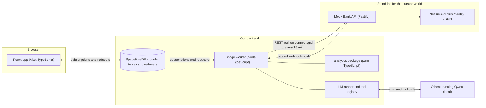
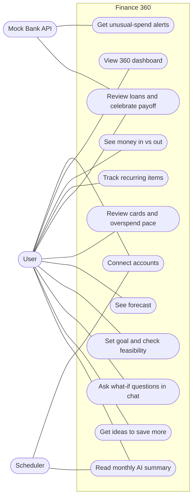
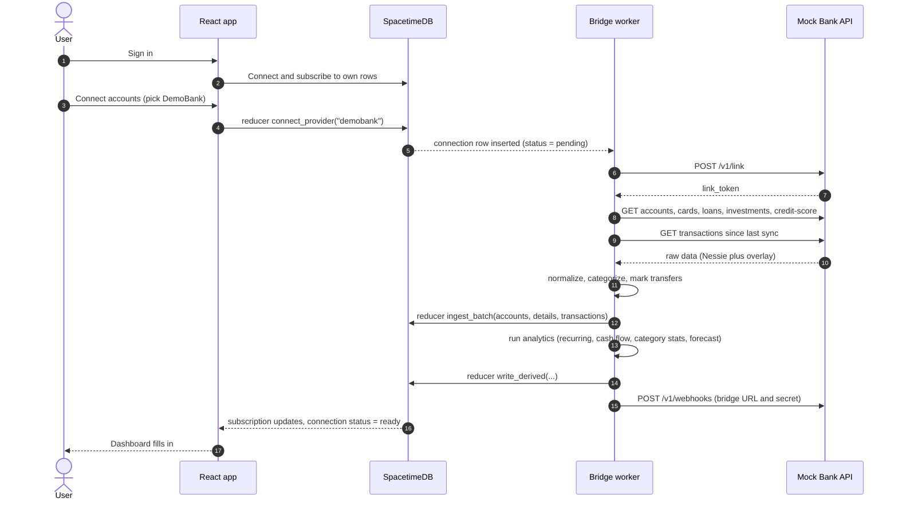
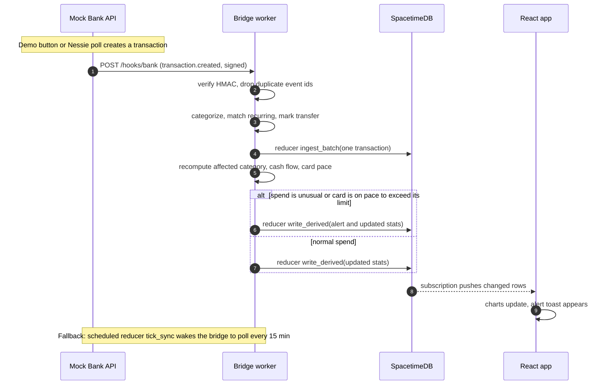
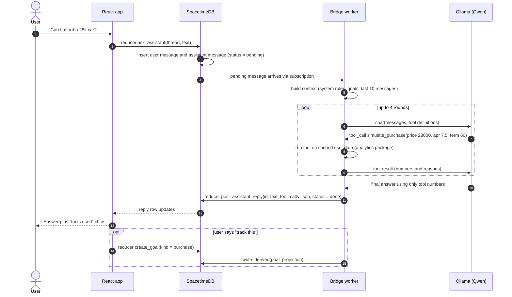
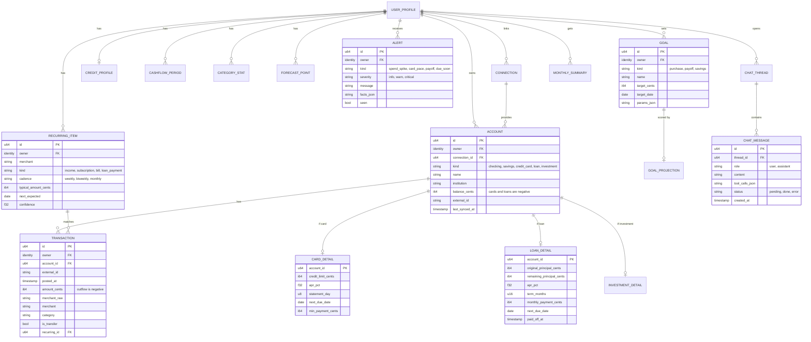
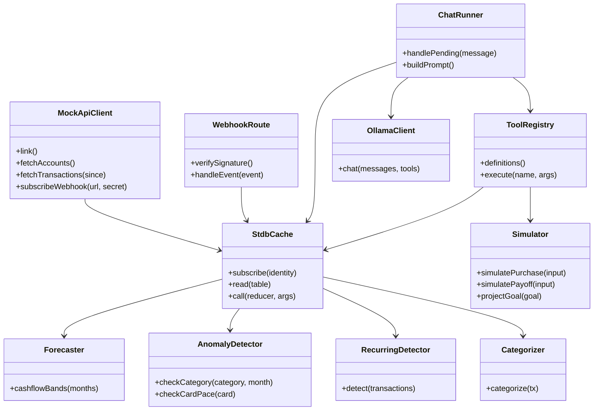

Contents

- [Decisions](#decisions)
- [Architecture](#architecture)
- [Use cases](#usecases)
- [Flows](#flows)
- [Data model](#data)
- [Code layout](#code)
- [LLM contract](#llm)
- [Mock API](#mockapi)
- [Build plan](#plan)
- [Caveats](#caveats)

Hackathon build pack

# Finance 360 Blueprint

How the pieces connect, what each flow does, the database schema, and how every table shows up in the UI and in the LLM's tools. Written so four people can build in parallel against the same contract.

SpacetimeDB · TypeScript + React · Ollama with Qwen · Fastify mock API over Nessie

## Decisions to lock in first

These resolve the open questions in the brief. Agree on them in the first hour, because every diagram below depends on them.

Mock API is its own service

A small Fastify app, not a SpacetimeDB module. It has to speak plain HTTP and send signed webhooks, like a real aggregator would. It wraps Nessie and adds the fields Nessie lacks.

One worker makes all HTTP calls

SpacetimeDB reducers should not call out to the network. A TypeScript "bridge" worker subscribes to the database, calls the mock API, receives webhooks, runs analytics and talks to Ollama. It writes results back through reducers.

The UI talks only to SpacetimeDB

The React app subscribes to tables and calls reducers. It never calls the mock API or Ollama directly, so there is no REST layer to build.

The LLM never does arithmetic

Every number in an answer comes from a tool call into the analytics package. The model explains results and asks follow-ups.

Money is integer cents

Outflows are negative. Cards and loans store balances as negative numbers. Timestamps are UTC, bucketed into months in one fixed timezone for the demo.

Derived data lives in tables

Cash flow, category stats, forecasts and goal projections are written once by the bridge and read by both the UI and the LLM tools. The chart and the chatbot can never disagree.

## System architecture



Solid arrows are the only network paths. The React app has no direct line to the mock API or Ollama.

| Component | Responsibility | Tech |
| --- | --- | --- |
| React app | Sign in, connect flow, dashboard charts, alerts, goals, chat panel. Read-only against subscriptions, writes through reducers. | Vite, React, Recharts, SpacetimeDB TS SDK |
| SpacetimeDB module | System of record. Tables, reducers, and scheduled "tick" reducers that wake the bridge. | SpacetimeDB module |
| Bridge worker | Pulls from the mock API, receives webhooks, normalizes data, runs analytics, runs the LLM loop, writes derived rows back. | Node, SpacetimeDB client SDK, Fastify (webhook route) |
| analytics package | Pure functions: categorize, recurring detection, anomalies, forecast, purchase and payoff simulations. Unit tested on the seed persona. | TypeScript |
| Mock Bank API | Behaves like a Plaid-style aggregator: link flow, REST data, signed webhooks. Includes `/sim` endpoints so the demo can trigger events on demand. | Fastify, Nessie client, overlay JSON |
| Ollama with Qwen | Local inference with tool calling. Writes explanations, monthly summaries and chat replies. | Ollama, Qwen3 8B or larger |

## Use cases



The mock API acts as an actor because its pushes trigger alerts and payoff events. The scheduler drives periodic syncs and the monthly summary.

| ID | Use case | Trigger | Reads | Result | Scope |
| --- | --- | --- | --- | --- | --- |
| UC1 | Connect accounts | User clicks "Connect", scheduler every 15 min | connection | Accounts, details and transactions land in the database | P0 |
| UC2 | 360 dashboard | Page load | account, \*\_detail | Net worth, balances by account type, last sync time | P0 |
| UC3 | Money in vs out | Page load, toggle week or month | cashflow_period | Bars for income and expenses, line for net | P0 |
| UC4 | Recurring items | Page load | recurring_item | Paychecks, subscriptions, bills and loan payments with next expected date | P0 |
| UC5 | Unusual-spend alert | New transaction webhook | category_stat | Toast and entry in the alert feed | P1 |
| UC6 | Loans and payoff celebration | Page load, `loan.paid_off` event | loan_detail | Balance, remaining principal, APR, next due date, confetti on payoff | P1 |
| UC7 | Cards and overspend pace | Page load, new card transaction | card_detail, credit_profile | Limit, utilization, due date, credit score, "on pace to exceed" alert | P1 |
| UC8 | Forecast | Page load | forecast_point | Three-month balance band (p10, p50, p90) | P1 |
| UC9 | Goal and feasibility | User creates a goal | goal, goal_projection | On-track meter, monthly amount needed vs available | P1 |
| UC10 | What-if chat | User sends a message | chat_message plus tools | Answer grounded in tool results, with "facts used" chips | P0 |
| UC11 | Ideas to save more | Dashboard card, or chat request | loan_detail, recurring_item | Ranked suggestions with dollar impact, such as interest saved by paying a loan faster | P2 |
| UC12 | Monthly AI summary | Scheduler on the 1st, or a manual button | cashflow_period, category_stat, alert | One short paragraph plus three highlights | P1 |

P0 means the demo does not work without it. P1 should ship. P2 only if time is left.

## Key flows

### Sign in and connect accounts



SpacetimeDB identities are anonymous tokens by default. For the demo, "sign in" can be a persona picker that maps to a seeded customer.

### Live update when a transaction happens



The polling fallback means a dropped webhook costs at most 15 minutes of staleness.

### Ask the assistant about a decision



The chat needs no REST endpoint. A message is a row, the bridge watches for pending rows, and the reply is another row update.

## Data model



Attributes are shown for the tables the UI and LLM touch most. Remaining tables follow the same pattern: `id`, `owner`, plus the columns named in the map below.

### Schema to screens to LLM

| Table | Written by | Shown in the UI as | Reaches the LLM through |
| --- | --- | --- | --- |
| connection | Reducer `connect_provider`, bridge updates status | Connect button and sync status badge | Not used |
| account, card_detail, loan_detail, investment_detail | Bridge via `ingest_batch` | Net worth tile, account cards, loan card with payoff bar, credit card card | `get_snapshot`, `get_debts` |
| credit_profile | Bridge via `ingest_batch` | Credit score gauge on the cards page | `get_debts` |
| transaction | Bridge via `ingest_batch` | Searchable transaction list, drill-down from charts | Never sent raw. Tools return aggregates so a small model is not flooded with rows. |
| cashflow_period | Bridge via `write_derived` | Income vs expenses chart with net line | `get_cashflow` |
| category_stat | Bridge via `write_derived` | Spending breakdown with "vs usual" badges | `get_spending` |
| recurring_item | Bridge via `write_derived` | Recurring list grouped by income, subscriptions, bills | `get_recurring` |
| alert | Bridge via `write_derived` | Alert feed and toasts | Included in the monthly summary facts |
| forecast_point | Bridge via `write_derived` | Forecast band chart | `get_cashflow` (future months) |
| goal, goal_projection | User via `create_goal`, bridge writes projection | Goal tracker with feasibility meter | `project_goal`, and goal list in the system prompt |
| chat_thread, chat_message | User via `ask_assistant`, bridge via `post_assistant_reply` | Chat panel with "facts used" chips from `tool_calls_json` | Last 10 messages as history |
| monthly_summary | Bridge after one LLM call on a facts packet | Summary card on the dashboard | Output of the LLM, not an input |

### Reducers

| Reducer | Called by | What it does |
| --- | --- | --- |
| connect_provider(provider) | React app | Creates a `connection` row with status pending |
| ingest_batch(payload) | Bridge | Upserts accounts, details, transactions by `external_id` |
| write_derived(payload) | Bridge | Replaces derived rows (cash flow, stats, recurring, forecast, alerts, projections) |
| create_goal(...) | React app | Inserts a `goal`, bridge scores it |
| ask_assistant(thread, text) | React app | Inserts the user message and a pending assistant message |
| post_assistant_reply(id, text, tool_calls_json, status) | Bridge | Completes the pending assistant message |
| mark_alert_seen(id) | React app | Clears the unread badge |
| tick_sync, tick_monthly | Scheduler | Insert a "job" row the bridge reacts to. They do no network work themselves. |

## Code layout

repo layout

```
finance360/
  apps/
    web/           React + Vite + TypeScript, generated SpacetimeDB bindings
    bridge/        Node worker: sync, webhook route, analytics runs, LLM loop
    mock-api/      Fastify: Nessie adapter, overlay data, /v1/*, /sim/*
  packages/
    shared/        types.ts, enums, money helpers (cents), config thresholds
    analytics/     pure TS functions, unit tested
  spacetime/       module: tables and reducers
  seed/            demo persona JSON (12 months of data, planted patterns)
```



Everything in the analytics group takes plain data in and returns plain data out, so it can be tested without SpacetimeDB or Ollama running.

### Analytics rules at a glance

| Function | Method | Writes |
| --- | --- | --- |
| categorize | Merchant keyword rules first, then Nessie's own merchant category. Only unknown merchants go to the LLM, in one batch, cached by merchant. | transaction.category |
| markTransfers | Pair equal and opposite amounts across the user's own accounts within 3 days. Excluded from income and expense totals. | transaction.is_transfer |
| detectRecurring | Group by merchant, require intervals within 3 days of a cadence and amounts within 10%. | recurring_item |
| checkCategory | Compare this month's category spend with the median and MAD of the previous 6 months. Ignore spikes under a dollar floor. | alert, category_stat |
| checkCardPace | Spend so far divided by the share of the statement cycle elapsed, compared with the credit limit. | alert |
| cashflowBands | Known recurring items plus median variable spend, with a Monte Carlo run for p10, p50 and p90. | forecast_point |
| simulate\*, projectGoal | Amortization and cash-flow arithmetic. No ML. | goal_projection, tool results |

packages/shared/types.ts (excerpt)

```
// Money is integer cents. Outflows are negative.
export type AccountKind = "checking" | "savings" | "credit_card" | "loan" | "investment";

export type Category =
  | "income" | "housing" | "groceries" | "dining" | "transport" | "subscriptions"
  | "utilities" | "insurance" | "tuition" | "health" | "shopping" | "travel"
  | "fees" | "transfer" | "other";

export interface Tx {
  id: string;
  accountId: string;
  postedAt: string;        // ISO, UTC
  amountCents: number;
  merchantRaw: string;
  merchant: string;        // cleaned
  category: Category;
  isTransfer: boolean;
  recurringId?: string;
}

export interface PurchaseSimInput {
  priceCents: number;
  downPaymentCents: number;
  aprPct: number;
  termMonths: number;
  ownershipCostMonthlyCents?: number;   // insurance, fuel, upkeep
}

export interface PurchaseSimResult {
  paymentMonthlyCents: number;
  totalInterestCents: number;
  surplusBeforeCents: number;
  surplusAfterCents: number;
  paymentShareOfTakeHomePct: number;
  emergencyFundMonthsAfter: number;
  verdict: "comfortable" | "tight" | "stretch" | "not_advised";
  reasons: string[];                     // short sentences the LLM can quote
}
```

## LLM contract

The model has three jobs: choose which tools to call, explain the results, and write the monthly summary. It has no job that involves calculating.

### Tools

| Tool | Arguments | Returns | Backed by |
| --- | --- | --- | --- |
| get_snapshot | none | Net worth, balances by account type, last sync time | account, \*\_detail |
| get_cashflow | months (1 to 12, past or future) | Income, expenses and net per month, plus average net | cashflow_period, forecast_point |
| get_spending | month, optional category | Spend per category, usual range, spike flags | category_stat |
| get_recurring | optional kind | Items with amount and next date, monthly total | recurring_item |
| get_debts | none | Loans (balance, APR, payment, due date) and cards (balance, limit, utilization, due date), credit score | loan_detail, card_detail, credit_profile |
| simulate_purchase | PurchaseSimInput | PurchaseSimResult | analytics.simulatePurchase |
| simulate_payoff | loanId, extraPerMonthCents | Months saved, interest saved, new payoff date | analytics.simulatePayoff |
| project_goal | goalId | On-track percentage, monthly needed vs available, date range | analytics.projectGoal |

### Purchase verdicts

Starting thresholds for `simulate_purchase`. They live in one config file, so tune them against your demo persona.

| Verdict | Rule |
| --- | --- |
| comfortable | Payment plus ownership costs at most 10% of take-home pay |
| tight | Up to 15% |
| stretch | Up to 20% |
| not_advised | Above 20%, or monthly surplus after the purchase is negative |

Emergency fund below 3 months of expenses after the down payment moves the verdict down one level. Take-home pay comes from the user's recurring income items.

system prompt (core rules)

```
You are the Finance 360 assistant. Rules:
1. Never calculate or recall numbers yourself. Every figure must come from a
   tool result in this conversation.
2. If a figure is needed and no tool provides it, say so.
3. Write amounts in dollars, rounded to the nearest dollar.
4. Give one or two concrete options. Say what changes in the user's monthly surplus.
5. You are not a financial advisor. When the verdict is "stretch" or
   "not_advised", or the decision is large, suggest talking to a licensed
   advisor and list the facts from the user's own data to bring along.
6. If data was last synced more than 24 hours ago, say when.
```

### Monthly summary

No tools. The bridge builds one JSON "facts packet" (income, spend, net, top three category changes, new recurring items, alerts, goal progress) and sends it with a prompt asking for one paragraph and three highlights. The result is stored in `monthly_summary` together with the packet, so the UI can show what the summary was based on.

### Ideas to save more

Candidates come from deterministic code, such as `simulate_payoff` over each loan with a few extra-payment amounts, and subscriptions that overlap in category. The LLM only ranks and phrases them. This keeps the dollar impact exact.

## Mock Bank API contract

| Endpoint | Purpose |
| --- | --- |
| POST /v1/link | Exchange a customer id for a `link_token` |
| GET /v1/accounts | Checking and savings accounts with balances |
| GET /v1/accounts/{id}/transactions?since= | Transactions after a timestamp, newest first |
| GET /v1/cards | Balance, limit, APR, statement day, due date, minimum payment |
| GET /v1/loans | Original and remaining principal, APR, term, payment, next due date |
| GET /v1/investments | Roth IRA, 401(k) and brokerage balances, year-to-date contributions |
| GET /v1/credit-score | Score and as-of date |
| POST /v1/webhooks | Register a callback URL and shared secret |
| POST /sim/transaction | Demo only: create a transaction and fire the webhook |
| POST /sim/loan-payoff | Demo only: pay a loan to zero and fire `loan.paid_off` |
| POST /sim/advance-day | Demo only: move the mock clock so due dates and cycles change |

webhook payload (header X-Signature: HMAC-SHA256 of the body)

```
{
  "id": "evt_01HZX",
  "type": "transaction.created",
  "customer_id": "cust_maya",
  "occurred_at": "2026-11-07T21:14:00Z",
  "data": {
    "account_id": "acc_checking_1",
    "transaction": {
      "id": "txn_88231",
      "amount_cents": -4599,
      "merchant": "TRADER JOES #123",
      "posted_at": "2026-11-07T21:14:00Z"
    }
  }
}
// other types: balance.updated, loan.paid_off, card.statement_closed
```

### Nessie to mock API mapping

From Nessie

Customers, accounts, purchases, deposits, withdrawals, transfers, bills and merchants. Purchases and withdrawals become negative transactions, deposits become positive ones.

From the overlay file

APR, credit limits, statement and due dates, investment accounts, credit score, and loan terms. Nessie's coverage of these is thin, so keep them in `seed/overlay.json` keyed by customer id.

Fallback

An environment flag, `DATA_SOURCE=nessie|seed`, switches the adapter to a fully local persona so the demo works with no internet.

## Build plan

Four lanes. With fewer people, merge A with B and C with D. Hour 1 is a contract freeze: `shared/types.ts`, table schema, tool signatures and mock API shapes. After that, each lane works against fixtures from the seed persona.

| Lane | Owns | First deliverable | Blocked by |
| --- | --- | --- | --- |
| A. Data | Mock API, Nessie adapter, seed persona, `/sim` endpoints | Seed persona JSON with 12 months of data and planted patterns | Nothing |
| B. Backend | SpacetimeDB module, bridge sync and webhook route | Schema published, TypeScript bindings generated | Contract freeze |
| C. Analytics and LLM | analytics package, tool registry, chat runner, Ollama setup | Functions and tests running on the seed JSON, no database needed | Seed persona |
| D. Frontend | Dashboard, accounts, recurring, goals, chat panel | Screens rendering from fixtures that match the shared types | Contract freeze |

| Hours | Milestone |
| --- | --- |
| 0 to 1 | Contract freeze, repo skeleton, Ollama model pulled and warmed |
| 1 to 6 | Parallel build against fixtures |
| 6 to 8 | Integration: connect flow works end to end, dashboard shows live rows |
| 8 to 10 | Webhook alerts, goals, chat with tool calls, monthly summary |
| 10 to 12 | Polish, rehearse the demo path, record a backup video |

### Demo path

1. Pick the seeded persona and connect accounts. The dashboard fills in.
2. Show cash flow, recurring items and the loan card.
3. Press the sim button to add a large dining charge. The spend alert appears live.
4. Ask the assistant whether a $28,000 car is feasible. Open the "facts used" chips.
5. Save it as a goal and show the feasibility meter.
6. Trigger a loan payoff for the celebration.

## Caveats to plan around

- **Reducers and the network.** SpacetimeDB reducers are meant to be deterministic and should not make outbound HTTP calls. Newer releases are adding ways to do this, so check your version, but do not make the demo depend on it. The bridge worker is the safe default.
- **Table visibility.** Public tables can be read by any connected client. For the demo, filter subscriptions by `owner` and say in the pitch that production needs row-level security.
- **Local model reliability.** Small Qwen models sometimes call tools badly or skip them. Use an 8B model or larger, cap tool rounds at 4, and warm the model before presenting. Build a fallback mode by hour 8: the bridge precomputes the relevant tool results and sends them in a single prompt, with no tool calling.
- **Latency.** A laptop running Qwen may take 10 to 30 seconds per reply. Show a "checking your numbers" state that lists tools as they run, which also makes the grounding visible.
- **Nessie data and availability.** Nessie data is random and has no investments or card terms. Confirm the API is reachable and your key works in the first hour. Keep the seed persona as a working fallback.
- **Patterns need planting.** Recurring detection and anomaly alerts only look good when the data has patterns. Generate the seed persona with rent, a subscription, biweekly pay, and one deliberate dining spike.
- **Transfers.** Moving money between your own accounts double-counts as spending and income. Mark transfers before computing any totals.
- **Not financial advice.** Keep the disclaimer in the system prompt and in the chat UI. The verdict thresholds above are rules of thumb, not recommendations for a specific person.
- **Privacy.** Running Qwen locally means no financial data leaves the machine. That is worth saying in the pitch.